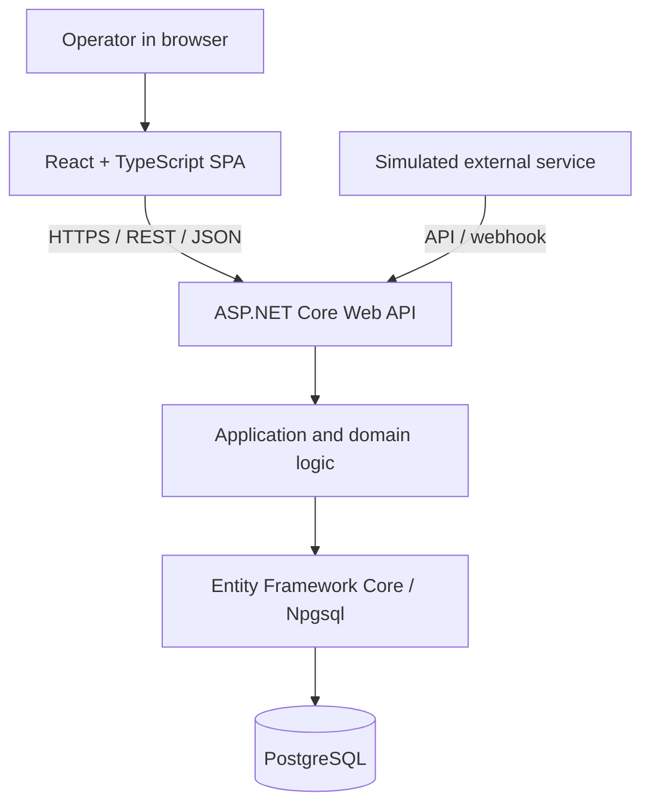

# Cargo Operations Platform

**A learning-focused full-stack project for internal transport operations.**

Cargo Operations Platform is a concept application for creating, tracking, and managing air-freight shipments. The project explores how to build a modern internal business platform using **React, TypeScript, ASP.NET Core, Entity Framework Core, and PostgreSQL**, supported by automated testing and production-like infrastructure.

> **Important:** This is an independent learning and portfolio project inspired by a public job advertisement from Air Cargo Logistics AS. It is **not** developed on behalf of the company and does not represent confirmed internal requirements, systems, or workflows. All customers and shipments must be fictional.

## Project Status

**Current phase: planning / initial setup.** The architecture and features described below are _planned_, not claims that the application, tests, CI/CD pipelines, or environments have already been implemented. Update this section as functionality is built and verified.

**First milestone:** An operator can create a shipment in React, save it to PostgreSQL through ASP.NET Core and EF Core, and then find it in the shipment list.

## The Problem We're Exploring

Transport and logistics require coordination between people, shipments, schedules, and external systems. An internal platform could potentially reduce manual work and make it easier to:

- Find up-to-date shipment information in one place.
- Identify delays and issues that require attention.
- Track who changed what, and when.
- Exchange information with other systems in a controlled way.
- Analyze historical data and improve workflows.

These are **hypotheses and design scenarios**, not documented problems at Air Cargo Logistics.

## Features and Milestones

### P0 — Working End-to-End Full-Stack Flow

- [ ] Create and retrieve fictional customers.
- [ ] Create shipments with a customer, reference number, origin, destination, dates, and weight.
- [ ] Validate API input and persist data using EF Core.
- [ ] Display a shipment list and shipment details in React.
- [ ] Handle loading states, empty results, errors, and invalid form submissions.
- [ ] Preserve data between restarts using a persistent PostgreSQL volume.
- [ ] Create and apply version-controlled EF Core migrations.

### P1 — Reliability and Realistic Workflows

- [ ] Support shipment status transitions and event history.
- [ ] Track delays and other issues separately from shipment status.
- [ ] Build an operations dashboard with key metrics.
- [ ] Add authentication and role-based authorization (`viewer`, `operator`, `admin`).
- [ ] Integrate a simulated external service with idempotent event processing.
- [ ] Add automated unit, integration, and end-to-end tests.
- [ ] Set up GitHub Actions, isolated staging/production environments, health checks, and a rollback procedure.

### P2 — Potential Extensions

- [ ] Support multiple legs per shipment.
- [ ] Add historical reporting and analytics.
- [ ] Add notifications and background jobs.
- [ ] Introduce real-time updates if the workflow requires them.

## Technology Stack

| Area                  | Planned technology                           | Why                                                               |
| --------------------- | -------------------------------------------- | ----------------------------------------------------------------- |
| Frontend              | React, TypeScript, Vite                      | Interactive SPA for authenticated users; SEO is not a requirement |
| Routing               | TanStack Router                              | Type-safe routes and URL parameters                               |
| Frontend server state | TanStack Query                               | Caching, mutations, and server-data synchronization               |
| Styling               | Tailwind CSS                                 | Consistent user interface                                         |
| Backend               | C#, ASP.NET Core Web API (.NET 10)           | REST API, business logic, and authorization                       |
| Database              | PostgreSQL                                   | Relational modeling, constraints, and SQL                         |
| ORM                   | Entity Framework Core + Npgsql               | Data access and version-controlled migrations                     |
| Local development     | Docker + Docker Compose                      | Reproducible services and persistent storage                      |
| CI/CD                 | GitHub Actions                               | Automated builds, tests, and deployments                          |
| Backend testing       | xUnit, WebApplicationFactory, Testcontainers | Business rules and API tests using real PostgreSQL                |
| Frontend testing      | Vitest, React Testing Library, MSW           | Components and data-driven UI                                     |
| E2E testing           | Playwright                                   | Critical user journeys in a browser                               |

The stack is currently an **architectural choice for this project**, not confirmation of the technologies Air Cargo Logistics uses.

## System Architecture

The initial architecture consists of **one React SPA, one ASP.NET Core API, and one PostgreSQL database** — a straightforward modular monolith with clear responsibilities.



**Key principles:** The frontend never connects directly to the database. The backend owns validation, authorization, and business rules. Status changes must be traceable, and external events must be handled safely even when duplicated or received out of order.

## Planned Repository Structure

The structure will be created incrementally. **Not all directories necessarily exist yet.**

```text
cargo-operations/
├── AGENTS.md
├── README.md
├── apps/
│   ├── web/                          # React / Vite / TypeScript
│   └── api/                          # ASP.NET Core + EF Core
├── tests/
│   ├── Cargo.UnitTests/
│   ├── Cargo.IntegrationTests/
│   └── e2e/                          # Playwright
├── infra/
│   ├── compose.yaml
│   └── compose.dev.yaml
├── .github/
│   └── workflows/
└── docs/
    ├── arkitektur-og-teknologier.md
    ├── project-scope.md
    ├── testing-strategy.md
    ├── progress-and-learning.md
    └── adr/
        └── 0001-spa-dotnet-postgres.md
```

The API can start as a single project. Separate domain, application, and infrastructure projects should only be introduced when there is a clear benefit.

## Getting Started Locally

### Prerequisites

- Git
- Docker with Compose v2
- .NET 10 SDK
- A Node.js version supported by the selected Vite version, and npm

### Local Setup

**Startup commands have not yet been verified**, because the source code, Compose files, and scripts have not been created or reviewed here. Once the first end-to-end feature is implemented, update this section with working commands to:

1. Copy the required variables from `.env.example` and supply local development values.
2. Start PostgreSQL, the API, and the frontend locally (using Compose where appropriate).
3. Apply EF Core migrations to the **development database**.
4. Open the application and verify a shipment all the way from UI to database.
5. Stop the services **without** deleting persistent volumes.

Never commit real passwords, API keys, or other secrets. Variables exposed through `VITE_*` are included in client-side code and must not contain secrets.

## Environments and Deployment

| Environment       | Purpose                               | Approach                                                    |
| ----------------- | ------------------------------------- | ----------------------------------------------------------- |
| Development       | Day-to-day development                | Local containers and fictional data                         |
| Staging           | Validate deployments and integrations | Separate database, secrets, and production-like setup       |
| Production (demo) | Stable version for demonstration      | Access control, backups, logging, and controlled deployment |

**Planned delivery flow:** Pull request → lint/build/tests → merge → build versioned image → deploy to staging → smoke/E2E tests → approved production deployment.

Production deployments and database changes must not happen automatically without appropriate safeguards. Reverting a Git commit does not undo database migrations or other external side effects.

## Testing Strategy

Tests should cover risks and real behavior rather than aim for a coverage percentage alone.

| Level                   | What to verify                                                     |
| ----------------------- | ------------------------------------------------------------------ |
| Backend unit            | Business rules, validation, and valid status transitions           |
| Backend integration     | HTTP endpoints, EF Core, and **real PostgreSQL** in isolated tests |
| Frontend unit/component | Forms, error states, and accessible behavior                       |
| Frontend integration    | UI interactions with simulated API responses using MSW             |
| Playwright E2E          | Create shipment → find it in the list → open its details           |
| Post-deployment         | Health checks and a short smoke test                               |

Once the test projects and npm scripts exist, document **verified** test commands here. Tests must never reset a shared staging or production database.

## Security and Data Integrity

- Use only synthetic customers and shipments; never use real business data.
- Validate inputs and enforce authorization on the server.
- Use foreign keys, unique reference numbers, appropriate database constraints, and transactions.
- Store timestamps consistently and handle time zones explicitly.
- Log meaningful events without exposing secrets.
- Use separate databases, identities, and secrets for each environment.
- Review migrations before deployment, and document backup and recovery procedures.

## Development Approach and Using Codex

This project is also a **learning environment**. The goal is to understand solutions and justify technical decisions, not merely generate finished code.

Agent behavior is defined in [`AGENTS.md`](AGENTS.md):

- **Guidance by default:** When asked for help, Codex should explain concepts and provide one manageable exercise at a time so the developer can write the code.
- **Implementation when explicitly requested:** When asked to implement something, Codex may modify code but must explain what changed, why, and how it was verified.
- **Code review without unsolicited edits:** During reviews, Codex should prioritize actual defects, risks, and learning opportunities.
- **Track progress:** Record verified milestones and learning points in [`docs/progress-and-learning.md`](docs/progress-and-learning.md).

## Further Reading

- [`docs/arkitektur-og-teknologier.md`](docs/arkitektur-og-teknologier.md) — technology stack, architecture, environments, and implementation order.
- [`docs/project-scope.md`](docs/project-scope.md) — requirements, scope, and acceptance criteria.
- [`docs/testing-strategy.md`](docs/testing-strategy.md) — testing levels and definition of done.
- [`docs/progress-and-learning.md`](docs/progress-and-learning.md) — current status, learning progress, and next exercise.
- [`docs/adr/0001-spa-dotnet-postgres.md`](docs/adr/0001-spa-dotnet-postgres.md) — rationale behind key architectural choices.

## Next Steps

1. Initialize the React/Vite project and the ASP.NET Core API.
2. Start a local PostgreSQL instance with Docker Compose.
3. Create the first EF Core entities and migration.
4. Implement `POST /api/shipments` and `GET /api/shipments`.
5. Connect the frontend to the API and demonstrate one complete user journey.
6. Add automated tests before expanding functionality further.

**Priority:** Build one working vertical slice first. Expand into integrations, security, broader test coverage, and additional environments once the core workflow is working.
