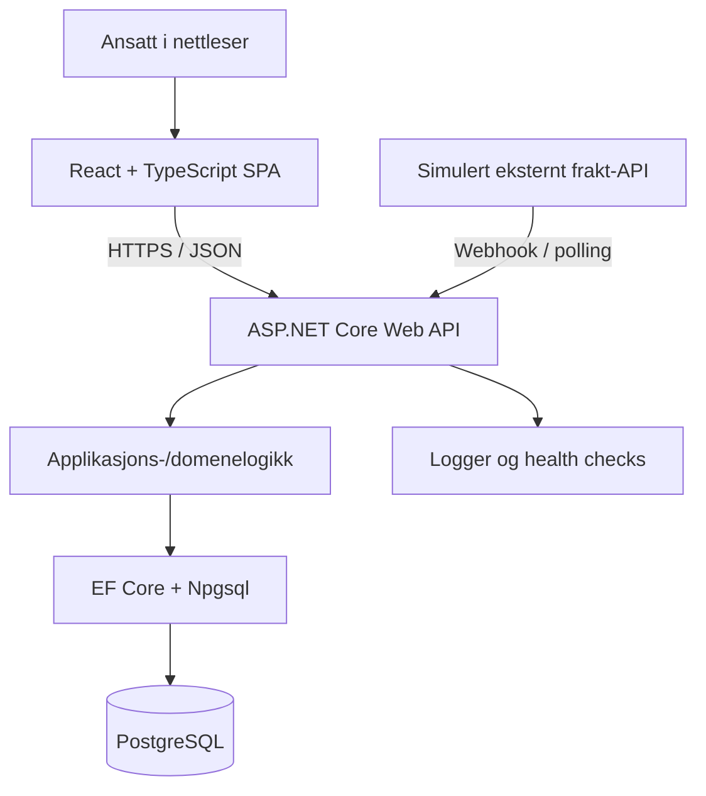

# Arkitektur og teknologier

> **Prosjekt:** Cargo Operations Platform – konseptprosjekt inspirert av stillingsannonsen til Air Cargo Logistics
> **Formål:** Demonstrere fullstack-utvikling, systemdesign, integrasjoner, testing, sikkerhet og drift gjennom én helhetlig applikasjon.
> **Sist oppdatert:** 19. oktober 2026
> **Premiss:** Dette er en selvstendig prototype basert på antakelser, **ikke** informasjon om Air Cargo Logistics' faktiske interne arkitektur eller systemer. Bruk kun fiktive data.

## 1. Mål og avgrensning

Bygg et internt websystem for administrasjon av flyfraktoppdrag. En operatør skal kunne opprette og følge opp transporter, registrere statushendelser, håndtere avvik og få en operasjonell oversikt. En simulert tredjepartstjeneste skal senere kunne rapportere statusendringer automatisk.

### Må demonstrere

- [ ] En komplett brukerflyt: React → .NET API → PostgreSQL → React.
- [ ] God domenemodellering, relasjoner og forretningsregler.
- [ ] En vedlikeholdbar og typesikker frontend og backend.
- [ ] Automatisert testing på relevante nivåer: unit, integrasjon og E2E.
- [ ] Reproduserbar lokal utvikling med Docker Compose.
- [ ] Isolerte **development**, **staging** og **production**-miljøer.
- [ ] CI/CD med trygge deployer, database-migrasjoner og en rollback-plan.
- [ ] Tilgangskontroll, validering, logging, overvåking og gjenoppretting.
- [ ] Teknisk dokumentasjon som forklarer valg og kompromisser.

### Ikke mål i første versjon

- Ikke gjenskap alle logistikkprosesser eller bygg et komplett ERP-system.
- Ikke bruk reelle kunde-, frakt- eller personopplysninger.
- Ikke bygg mikrotjenester, Kubernetes eller et eventdrevet økosystem bare for å demonstrere teknologier.
- Ikke implementer betalingsløsning, fakturering eller avansert sanntidssporing før kjernen fungerer.

**Prioriteringsnøkkel:** **P0** = første fungerende versjon; **P1** = produksjonslignende kvalitetsnivå; **P2** = interessante utvidelser. Fullfør P0 før du bygger ut P2.

---

## 2. Anbefalt teknologistack

| Område                    | Valg                                                        | Prioritet | Begrunnelse                                                     |
| ------------------------- | ----------------------------------------------------------- | --------- | --------------------------------------------------------------- |
| Frontend                  | React + TypeScript                                          | P0        | Interaktiv intern SPA og komponentbasert UI.                    |
| Build                     | Vite                                                        | P0        | Enkel frontend-bygging og rask lokal utvikling.                 |
| Routing                   | TanStack Router                                             | P0        | Typesikre ruter, søkeparametere og navigasjon.                  |
| Server-state              | TanStack Query                                              | P0        | Datahenting, caching, mutations og invalidation.                |
| Styling                   | Tailwind CSS                                                | P0        | Konsistente komponenter og effektiv styling.                    |
| Tabeller                  | TanStack Table                                              | P1        | Sortering, filtrering og paginering av transportoversikter.     |
| Skjema/validering         | React Hook Form + Zod                                       | P1        | Skjemaer og klientvalidering for brukeropplevelse.              |
| Backend                   | C# + ASP.NET Core Web API på **.NET 10 LTS**                | P0        | Relevant for stillingsannonsen; moden HTTP/API-plattform.       |
| API-stil                  | REST + JSON                                                 | P0        | En tydelig kontrakt mellom klient og server.                    |
| API-kontrakt              | OpenAPI                                                     | P1        | Dokumentasjon og generering av typesikker TS-klient.            |
| ORM                       | **Entity Framework Core 10**                                | P0        | Modellering, LINQ, transaksjoner og migrasjoner.                |
| Databaseprovider          | Npgsql EF Core-provider                                     | P0        | Knytter EF Core til PostgreSQL. Bruk kompatible majorversjoner. |
| Database                  | PostgreSQL                                                  | P0        | Relasjonsdata, constraints, indekser og SQL.                    |
| Lokal infrastruktur       | Docker + Docker Compose                                     | P0        | Reproduserbare tjenester og persistent test-/utviklingsdata.    |
| Versjonskontroll          | Git + GitHub                                                | P0        | Branches, PR-er, kodegjennomgang og historikk.                  |
| CI/CD                     | GitHub Actions                                              | P1        | Automatiserte sjekker, image-bygging og miljøbasert deploy.     |
| Container registry        | GitHub Container Registry (GHCR)                            | P1        | Versjonerte OCI-images for backend og eventuelt frontend.       |
| Frontend-unit/integrasjon | Vitest + React Testing Library + MSW                        | P1        | Teste komponentatferd og API-avhengig UI.                       |
| Backend-unit              | xUnit                                                       | P1        | Teste forretningsregler uten nettverk eller database.           |
| Backend-integrasjon       | WebApplicationFactory + Testcontainers for .NET             | P1        | Kjør API-et mot en ekte, midlertidig PostgreSQL.                |
| E2E                       | Playwright (TypeScript)                                     | P1        | Teste reelle brukerreiser i nettleser.                          |
| Logging                   | ASP.NET Core structured logging (ev. Serilog)               | P1        | Feilsøking med request-/korrelasjons-ID.                        |
| Observability             | Health checks + senere OpenTelemetry                        | P1 / P2   | Helsestatus først, traces og metrics ved behov.                 |
| Autentisering             | ASP.NET Core Identity eller ekstern OpenID Connect-provider | P1        | Verifisere ansatte og håndtere sesjoner sikkert.                |
| Autorisasjon              | Policy-/rollebasert autorisasjon i API-et                   | P1        | Tilganger håndheves på serversiden.                             |
| Drift                     | Én valgt host/plattform + TLS/reverse proxy                 | P1        | Reell staging/prod uten å bygge unødvendig infrastruktur.       |

**Versjonsvalg:** .NET 10 er en LTS-utgivelse med støtte til november 2028. EF Core 10 hører til .NET 10. Kontroller alltid kompatibiliteten mellom EF Core og Npgsql før du låser versjoner.

**Aktuelle alternativer:** React Router i stedet for TanStack Router; SQL Server i stedet for PostgreSQL hvis arbeidsgiveren faktisk bruker den; andre hoster enn én VPS. Disse er ikke nødvendige å implementere parallelt.

---

## 3. Foreslått systemarkitektur

**Anbefaling: modulær monolitt med separat SPA og API.** Ett .NET-backendprosjekt, én React-app og én PostgreSQL-database. Del logikken i moduler og tydelige lag, ikke i separate nettverkstjenester.



### Viktige arkitekturregler

- [ ] Frontend snakker med API-et, **aldri direkte** med PostgreSQL.
- [ ] Serveren validerer alle innkommende data, selv om React allerede har validert skjemaet.
- [ ] Forretningsregler bor i backend, ikke bare i React-komponenter.
- [ ] Autorisasjon håndheves på hvert relevant API-endepunkt.
- [ ] Database-operasjoner som må lykkes samlet, kjøres i én transaksjon.
- [ ] API-et returnerer tydelige statuskoder og et konsekvent feilformat (f.eks. Problem Details).
- [ ] Tjenester har tydelige ansvarsområder; unngå unødvendige abstraheringslag.

### Foreslått monorepo

```text
cargo-operations/
├── apps/
│   ├── web/                         # React + Vite + TypeScript
│   │   ├── src/
│   │   │   ├── routes/
│   │   │   ├── features/shipments/
│   │   │   ├── features/dashboard/
│   │   │   ├── components/
│   │   │   └── lib/api/
│   │   └── package.json
│   └── api/
│       ├── Cargo.Api/              # HTTP-endepunkter og composition root
│       ├── Cargo.Application/      # Use cases / forretningsflyt
│       ├── Cargo.Domain/           # Entiteter, invariants og regler
│       └── Cargo.Infrastructure/   # EF Core og integrasjoner
├── tests/
│   ├── Cargo.UnitTests/
│   ├── Cargo.IntegrationTests/
│   └── e2e/                         # Playwright (TS)
├── infra/
│   ├── compose.yaml
│   ├── compose.dev.yaml
│   ├── compose.staging.yaml
│   └── compose.prod.yaml
├── .github/workflows/
│   ├── ci.yaml
│   └── deploy.yaml
├── docs/
│   ├── architecture.md
│   ├── api.md
│   ├── deployment.md
│   ├── rollback.md
│   └── adr/
├── .env.example
└── README.md
```

**Merk:** Filstrukturen er et mulig mål, ikke noe som må opprettes før du skriver kode. Begynn gjerne med ett API-prosjekt og skill ut lag først når strukturen har en konkret nytte.

---

## 4. Funksjoner og domenemodell

### P0 – grunnleggende arbeidsflyt

- [ ] Opprett og vis kunder (`customers`).
- [ ] Opprett, hent, rediger og filtrer transportoppdrag (`shipments`).
- [ ] Registrer avreisested, destinasjon, vekt, forventet avgang/ankomst og ansvarlig operatør.
- [ ] Oppdater transportstatus med kontrollerte statusoverganger.
- [ ] Vis status og detaljer i React.
- [ ] Lag et dashboard med antall aktive, planlagte og fullførte sendinger.

### P1 – realistisk forretningsflyt

- [ ] Lagre hendelseshistorikk (`shipment_events`) uavhengig av gjeldende status.
- [ ] Registrer avvik (`shipment_issues`), f.eks. forsinkelse, uten å blande avvik og hovedstatus.
- [ ] Knytt hendelser og endringer til bruker og tidspunkt (audit trail).
- [ ] Innfør server-side paginering, filtrering og sortering i oversikten.
- [ ] Legg til roller som `viewer`, `operator` og `admin`.
- [ ] Demonstrer en simulert ekstern statusoppdatering.
- [ ] Beskytt mot duplikate eksterne hendelser (idempotency key / unik ekstern event-ID).
- [ ] Håndter samtidige oppdateringer, f.eks. med optimistic concurrency.

### P2 – videreutvikling

- [ ] Flere transportetapper (`shipment_legs`) med egen tidsplan/status per etappe.
- [ ] Rapporter og KPI-er (forsinkelser, volum, gjennomføringstid).
- [ ] Varsler om avvik.
- [ ] Bakgrunnsjobb for polling/synkronisering (f.eks. `BackgroundService`).
- [ ] Sanntidsoppdateringer med SignalR hvis arbeidsflyten faktisk krever det.
- [ ] Fil-/dokumenthåndtering med tilgangsstyring (ikke førsteprioritet).

### Første tabeller

| Tabell                 | Nøkkeldata                                                                           | Sentrale relasjoner           |
| ---------------------- | ------------------------------------------------------------------------------------ | ----------------------------- |
| `customers`            | id, name, customer_number                                                            | Én kunde har mange sendinger. |
| `shipments`            | id, reference, customer_id, origin, destination, status, planned times, weight       | Tilhører én kunde.            |
| `shipment_events`      | id, shipment_id, event_type, occurred_at, received_at, created_by, external_event_id | Mange hendelser per sending.  |
| `users`                | id, display_name, role / identity mapping                                            | Hvem som gjør endringer.      |
| `shipment_issues` (P1) | id, shipment_id, type, status, severity, resolved_at                                 | Flere avvik per sending.      |

**Databaseprinsipper:**

- [ ] Fremmednøkler, `NOT NULL`, `UNIQUE` og passende `CHECK`-constraints.
- [ ] Unik intern referanse for hver sending.
- [ ] Indekser på vanlig brukte filterfelt, f.eks. status + avreisedato.
- [ ] Avtal og håndhev tidsformat (UTC i lagring; lokal tid i UI).
- [ ] Bruk eksakte desimaltall for vekt og beløp, ikke flyttall.
- [ ] Bruk migrasjoner for schemaendringer; aldri bare manuelle SQL-endringer i prod.
- [ ] Skill mellom `occurred_at` (når noe skjedde) og `received_at` (når systemet fikk vite det).

---

## 5. Backend: .NET, API og ORM

### P0

- [ ] Lær C#-grunnlaget: klasser/records, interfaces, nullable types, LINQ, async/await og exceptions.
- [ ] Lag et ASP.NET Core Web API med DI og tydelig konfigurasjon.
- [ ] Lag REST-endepunkter med korrekte HTTP-metoder og statuskoder.
- [ ] Sett opp EF Core + Npgsql og `DbContext`.
- [ ] Opprett og kjør migrasjoner lokalt.
- [ ] Hold databasekall asynkrone der det er hensiktsmessig.

### P1

- [ ] Bruk DTO-er for request/response; ikke eksponer EF-entitetene ukritisk.
- [ ] Legg til server-side validering og sentralisert feilhåndtering.
- [ ] Dokumenter API-et med OpenAPI og generer en TypeScript-klient (f.eks. `openapi-typescript` + `openapi-fetch`).
- [ ] Håndhev domeneregler i backend, f.eks. tillatte statusoverganger.
- [ ] Bruk transaksjoner ved sammensatte endringer (status + historikk).
- [ ] Gjør eksterne events idempotente.
- [ ] Håndter kansellering, timeouts og retry-strategier for utgående HTTP-kall (unngå ukontrollerte retries).
- [ ] Legg til API-paginering, filtrering og sortering.
- [ ] Implementer autentisering/autorisasjon.

### API-endepunkter (forslag)

```http
GET    /api/shipments
POST   /api/shipments
GET    /api/shipments/{id}
PATCH  /api/shipments/{id}
GET    /api/shipments/{id}/events
POST   /api/shipments/{id}/events
GET    /api/dashboard/summary
POST   /api/integrations/mock/events   # P1; sikres særskilt
GET    /health/live
GET    /health/ready
```

**Unngå:** å lage et «generic repository»-lag bare for å skjule EF Core; unødvendig CQRS/MediatR før det finnes et behov; og å la en offentlig tilgjengelig mock-webhook være usikret.

---

## 6. Frontend: React SPA

### P0

- [ ] React + TypeScript med Vite.
- [ ] Oversiktsside for sendinger og detaljside for en sending.
- [ ] Skjema for å opprette en sending.
- [ ] TanStack Router for navigasjon.
- [ ] TanStack Query for datahenting og mutations.
- [ ] God håndtering av loading, empty states og feil.

### P1

- [ ] Filtrering/sortering/paginering via URL og backend.
- [ ] React Hook Form + Zod for skjemavalidering.
- [ ] TanStack Table for datatunge oversikter.
- [ ] Generert typesikker API-klient fra OpenAPI.
- [ ] Tilgangsstyrt navigasjon i UI (men serveren bestemmer tilgangen).
- [ ] Tilgjengelighet: tastaturnavigasjon, labels, fokusindikator og kontrast.
- [ ] Fornuftig håndtering av stale data og samtidig redigering.

**State-prinsipp:** Serverdata i TanStack Query, skjemadata i skjemaet, lokal UI-state i React. Ikke innfør Redux bare fordi prosjektet er stort.

---

## 7. Docker og Docker Compose

### P0 – lokal utvikling

- [ ] `Dockerfile` for .NET API med multi-stage build.
- [ ] Container for PostgreSQL med navngitt volume.
- [ ] Docker Compose for `web`, `api` og `db` (eventuelt web lokalt under tidlig utvikling).
- [ ] Intern Docker-nettverkskommunikasjon med tjenestenavn.
- [ ] Health checks og oppstart som tåler at databasen ikke er klar umiddelbart.
- [ ] Hot reload for frontend og en praktisk utviklerflyt for backend.
- [ ] `.dockerignore` og `.gitignore`.
- [ ] Dokumenter kommandoer for start, stopp, logs og database-reset.

### P1 – deploybare images

- [ ] Produksjonsimage for API uten SDK eller utviklingsavhengigheter.
- [ ] Bygg React til statiske filer; server via statisk webserver eller hosting-plattform.
- [ ] Kjør containere med minst mulige privilegier og ikke-root der det er mulig.
- [ ] Lagre sensitive verdier i secret store / miljø, aldri i image eller repo.
- [ ] Versjoner images med commit SHA eller immutable image digest, ikke bare `latest`.
- [ ] Begrens eksponerte porter; database skal normalt ikke være åpen på internett.

**Avgrensning:** Docker Compose er svært godt egnet lokalt og kan brukes på én VPS i staging/prod. Det er ikke nødvendig med Kubernetes for denne prototypen.

---

## 8. Development, staging og production

| Miljø           | Formål                              | Frontend           | API                | Database                        | Data                                    |
| --------------- | ----------------------------------- | ------------------ | ------------------ | ------------------------------- | --------------------------------------- |
| **Development** | Rask lokal utvikling                | Lokal Vite/Compose | Lokal .NET/Compose | Lokal PostgreSQL-container      | Seedet fiktiv testdata                  |
| **Staging**     | Teste nesten samme oppsett som prod | Egen staging-URL   | Egen deploy        | **Separat** PostgreSQL-database | Fiktiv, forutsigbar testdata            |
| **Production**  | Demonstrere reell drift             | Egen prod-URL      | Egen deploy        | **Separat** PostgreSQL-database | Bare fiktiv demodata i dette prosjektet |

### Miljøkrav (P1)

- [ ] Staging og production har egne URL-er, secrets, databasebrukere og databaser.
- [ ] Hvert miljø har separat persistent lagring og egne konfigurasjoner.
- [ ] Frontend og API eksponeres over HTTPS; vurder samme origin med `/api` via reverse proxy.
- [ ] Konfigurer CORS restriktivt dersom frontend og API bruker ulike origins.
- [ ] Ingen kobling fra staging til prod-database.
- [ ] Staging ligner prod mest mulig når det gjelder versjoner og kjøremåte.
- [ ] Frontend har riktig offentlig API-konfigurasjon i hvert miljø; verdier eksponert via `VITE_*` er **ikke hemmeligheter**.
- [ ] Bruk runtime-konfigurasjon for frontend om du vil promotere nøyaktig samme statiske build mellom staging og prod; ellers dokumenter at frontend må bygges per miljø.
- [ ] Sett klare grenser for ressurser, logging og lagring for å holde kostnadene nede.

**Kostnad/kompleksitet:** Tre miljøer betyr ikke tre Kubernetes-klynger. Start med lokal dev og en liten host for staging/prod med isolerte containere, databaser og nettverk – eller bruk en hostingplattform som tilbyr separate miljøer. Full produksjonsdrift kan vente til MVP er stabil.

---

## 9. Teststrategi: unit, integrasjon, E2E

**Målet er god dekning av risiko og kritiske brukerreiser, ikke flest mulig tester.** Bruk flere raske unit-tester, færre integrasjonstester og et lite antall stabile E2E-tester.

| Testnivå                | Verktøy                                           | Hva testes?                                                   | Når?          |
| ----------------------- | ------------------------------------------------- | ------------------------------------------------------------- | ------------- |
| Backend unit            | xUnit                                             | Statusoverganger, validerings-/domeneregler, beregninger      | Hver PR       |
| Backend integrasjon     | WebApplicationFactory + Testcontainers PostgreSQL | API-ruter, databaseoperasjoner, autorisasjon og migrasjoner   | Hver PR       |
| Frontend unit/komponent | Vitest + React Testing Library                    | Rendering, skjematilstand, feil- og loading-states            | Hver PR       |
| Frontend integrasjon    | React Testing Library + MSW                       | Brukerinteraksjoner som utløser API-requests og viser respons | Hver PR       |
| E2E                     | Playwright                                        | Hele brukerreisen med reell frontend, API og testdatabase     | CI og staging |
| Smoke test              | HTTP + enkel Playwright-/API-sjekk                | App starter, API er tilgjengelig og hovedflyt fungerer        | Etter deploy  |

### Viktigste konkrete tester (P1)

**Backend unit**

- [ ] Status kan endres fra `CREATED` til `BOOKED`.
- [ ] Ugyldig overgang avvises, f.eks. `DELIVERED` til `CREATED`.
- [ ] Ugyldig vekt eller manglende referanse avvises.

**Backend integrasjon – med ekte PostgreSQL**

- [ ] `POST /api/shipments` lagrer gyldig transport og returnerer korrekt status.
- [ ] `GET /api/shipments/{id}` returnerer riktig informasjon og 404 når den ikke finnes.
- [ ] Opprettelse av hendelse lagrer historikk og oppdaterer status i samme transaksjon.
- [ ] Duplikat eksternt event skaper ikke dobbel hendelse.
- [ ] Bruker uten rettigheter får 403; uautentisert får 401 der det er relevant.
- [ ] Migrasjonene kan kjøres på en tom database.

**Frontend unit/integrasjon**

- [ ] Liste viser sendinger, loading-state og tomtilstand.
- [ ] Feilmelding vises ved API-feil.
- [ ] Skjema stopper ugyldig input og sender gyldig data.
- [ ] Filter/sortering gir korrekt UI og/eller request-parametere.

**E2E med Playwright**

- [ ] Logg inn med testbruker (når auth er implementert).
- [ ] Opprett transport → se transport i oversikt → åpne detaljside.
- [ ] Registrer hendelse → bekreft oppdatert status og historikk.
- [ ] Simuler forsinkelse → avvik vises på dashboard.
- [ ] Bekreft at bruker uten tillatelse ikke får gjøre beskyttet endring.

### Testdata og pålitelighet

- [ ] Separate og isolerte testdatabaser; aldri kjør destruktive E2E-tester mot prod.
- [ ] Seed deterministisk data og rydd opp mellom tester.
- [ ] Bruk ekte PostgreSQL i databaseintegrasjonstester; ikke stol på EF InMemory som fullgod erstatning.
- [ ] Mock bare eksterne tjenester der det er hensiktsmessig; behold egne API-/DB-kall ekte i integrasjonstester.
- [ ] Lag rapporter/artifacts for feilede Playwright-tester (screenshots, trace).
- [ ] Test både positive og negative tilfeller.

---

## 10. CI/CD og GitHub-arbeidsflyt

### Branches og kvalitetssikring

- [ ] `main` beskyttes mot direkte push.
- [ ] Feature branches og små PR-er med forklaring på endringer og testplan.
- [ ] Obligatoriske CI-sjekker før merge.
- [ ] Formatering, lint og typecheck i CI (`eslint`, `tsc`, `dotnet format`/analyzers).
- [ ] Bygg frontend/API og kjør automatiserte tester.
- [ ] Dependency-oppdateringer og sårbarhetssjekk (Dependabot/Renovate; ev. container scanning).
- [ ] Beskriv eventuelle breaking changes og database-migrasjoner i PR-en.

### Foreslått deploy-pipeline

```mermaid
flowchart LR
    PR[Pull request] --> CI[Lint + Build + Tests]
    CI -->|grønn + review| MAIN[Merge main]
    MAIN --> IMG[Bygg og publiser image med SHA]
    IMG --> STG[Deploy staging]
    STG --> E2E[Smoke + Playwright E2E]
    E2E -->|godkjent| APP[Manuell production approval]
    APP --> PROD[Promoter samme backend-image til prod]
    PROD --> SMOKE[Prod smoke + observability]
```



**Viktig:** CI tester kode. CD promoter en spesifikk versjon. Skill mellom å bygge et image og å deploye det; samme versjon skal kunne identifiseres og rulles tilbake.

### Miljøbeskyttelse (P1)

- [ ] GitHub Environments for `staging` og `production`.
- [ ] Produksjonsdeploy krever eksplisitt godkjenning hvis plattform/repo-plan støtter det, ellers en tilsvarende godkjenningsmekanisme.
- [ ] Egen secret-scope per miljø.
- [ ] Unngå langsiktige cloud-nøkler når OIDC/kortlevde credentials støttes.
- [ ] Deploy låses slik at to samtidige utrullinger ikke konkurrerer.
- [ ] Verifiser health checks etter deploy og stopp videre utrulling ved feil.

### Trygge database-migrasjoner

- [ ] Opprett EF Core-migrasjoner i kode og review endringene.
- [ ] Test dem først på en fersk database og i staging.
- [ ] Bruk EF Core **migration bundle** eller gjennomgått SQL-script som separat deploy-steg i prod.
- [ ] Bruk en separat migreringsidentitet med schema-rettigheter; API-et trenger normalt færre privilegier.
- [ ] Planlegg bakoverkompatible schemaendringer (expand → migrate → contract) ved behov.
- [ ] Ta backup før risikable endringer, og test restore-prosedyren.

**Unngå:** å kjøre migrasjoner ukritisk ved oppstart av alle app-instanser, å gi appbrukeren schema-admin-rettigheter, og å regne med at `git revert` automatisk ruller tilbake databasen.

---

## 11. Sikkerhet

### P1 – prioritert

- [ ] Autentisering (ASP.NET Core Identity for egen løsning, eller ekstern OIDC-provider hvis tilgjengelig).
- [ ] Sikker sesjons-/tokenhåndtering; for nettleserbasert intern app er sikre `HttpOnly`-cookies ofte et godt valg, med riktig CSRF-beskyttelse.
- [ ] Autorisasjon på serversiden basert på roller/policies og eierskap/tilgang.
- [ ] Secrets utenfor Git, images og frontend-bundles.
- [ ] TLS/HTTPS, sikre headers og stram CORS-policy.
- [ ] Inputvalidering og beskyttelse mot injeksjon (ORM betyr ikke at all rå SQL er trygg).
- [ ] Begrenset nettverkstilgang til database og administrative endepunkter.
- [ ] Rate limiting for relevante endepunkter, særlig auth og integrasjoner.
- [ ] Ikke logg passord, tokens, personopplysninger eller hele sensitiv request-body.
- [ ] Hold pakker og container-baseimages oppdatert.

### P2 – ekstra bredde

- [ ] Kort trusselmodell: aktører, assets, angrepsflater og tiltak.
- [ ] Sikkerhetstesting for tilgangsbrudd og feilkonfigurasjoner.
- [ ] Audit logging for kritiske endringer med sporbarhet.
- [ ] Sårbarhetsskanning av images og dependencies.

**Spesielt viktig:** En intern applikasjon er ikke automatisk sikker fordi den er skjult for søkemotorer. Tilgang til interne data må fortsatt beskyttes på API- og datanivå.

---

## 12. Logging, observability og drift

### P1

- [ ] Strukturerte logger med nivå (`Information`, `Warning`, `Error`).
- [ ] Korrelasjons-/request-ID så frontend- og backend-feil kan spores.
- [ ] Health endpoints: **liveness** (prosessen lever) og **readiness** (kan betjene trafikk).
- [ ] Logg feil fra integrasjoner med nyttig kontekst, men uten hemmeligheter.
- [ ] Overvåk applikasjonens tilgjengelighet og varsle ved nedetid.
- [ ] Registrer hvilken commit/image-versjon som kjører i hvert miljø.
- [ ] Definer hva som skal skje når database, API eller en ekstern integrasjon feiler.

### P2

- [ ] OpenTelemetry for traces og metrics (kan visualiseres i en kompatibel stack).
- [ ] Dashboard for feilrate, responstid og ressurser.
- [ ] Varsling ved høy feilrate eller vedvarende integrasjonsfeil.
- [ ] Sentry eller lignende frontend-feilrapportering hvis nødvendig.

**Ikke overbygg:** Du trenger ikke sette opp Prometheus + Grafana + Loki + Jaeger fra dag én. God logging, health checks og en fungerende feilsøkingsrutine er mer verdifullt først.

---

## 13. Backup, gjenoppretting og rollback

### P1

- [ ] Automatisk backup av prod-database (og staging dersom dataene må bevares).
- [ ] Backup lagres uavhengig av aktiv database/host, med begrenset tilgang.
- [ ] Dokumenter retention samt ønsket RPO (akseptabelt datatap) og RTO (akseptabel nedetid).
- [ ] Kjør en faktisk **restore-test** til en isolert database.
- [ ] Dokumenter hvordan forrige kjente fungerende backend-image og frontend-versjon redeployes.
- [ ] Skill mellom **kode-rollback** og **database-rollback**.
- [ ] Test rollback av en ufarlig deploy i staging.
- [ ] Bruk bakoverkompatible migrasjoner slik at forrige appversjon kan kjøre mot nytt schema der det er mulig.

**Viktig:** Docker volumes er vedvarende lagring, ikke backup. Revert av Git-commit reverserer ikke nødvendigvis migrasjoner, dataendringer eller secrets.

---

## 14. Dokumentasjon som viser profesjonalitet

- [ ] `README.md`: prosjektets formål, stack, skjermbilder, arkitektur og oppstart.
- [ ] `docs/architecture.md`: diagram, komponenter, dataflyt og avgrensninger.
- [ ] `docs/api.md`: API-kontrakt, eksempler og OpenAPI-lenke.
- [ ] `docs/deployment.md`: dev/staging/prod, deploy-prosess og secrets (uten verdier).
- [ ] `docs/rollback.md`: konkrete steg ved feil deploy og databasehendelser.
- [ ] `docs/adr/`: korte Architecture Decision Records, f.eks. «Hvorfor SPA?», «Hvorfor .NET + PostgreSQL?», «Hvorfor modulær monolitt?».
- [ ] ER-diagram over databasen og beskrivelse av sentrale regler.
- [ ] Teststrategi, CI-status og en liste over kjente begrensninger.
- [ ] Kort demo-video eller GIF av én komplett brukerreise.

**En ADR kan være kort:** Kontekst → beslutning → alternativer → konsekvenser. Å forklare _hvorfor_ er ofte mer imponerende enn å vise mange biblioteker.

---

## 15. Anbefalt implementeringsrekkefølge

### Fase 1 – Vertikal MVP (P0)

- [ ] Opprett Git-repo og enkel README.
- [ ] Sett opp React + TypeScript + Vite.
- [ ] Sett opp ASP.NET Core 10 API.
- [ ] PostgreSQL i Docker Compose.
- [ ] EF Core + Npgsql + første migrasjon.
- [ ] Bygg `POST /shipments` og `GET /shipments`.
- [ ] Bygg React-skjema og transportoversikt.
- [ ] Få hele flyten til å fungere lokalt.

**Ferdig når:** En sending kan opprettes via UI, lagres i PostgreSQL og vises ved ny lasting.

### Fase 2 – Domenemodell og kvalitet

- [ ] Hendelseshistorikk og kontrollerte statusendringer.
- [ ] De viktigste backend-unit-testene.
- [ ] Backend-integrasjonstester med ekte PostgreSQL.
- [ ] Frontend komponent-/integrasjonstester.
- [ ] En første Playwright E2E-test.
- [ ] OpenAPI og typesikker frontend-klient.

**Ferdig når:** Hovedflyten er testet og tåler ugyldige inputs.

### Fase 3 – Integrasjon og sikkerhet

- [ ] Simulert ekstern hendelse / webhook.
- [ ] Idempotens, feilscenarier og hendelseslogg.
- [ ] Autentisering og rollebasert autorisasjon.
- [ ] Logging, health checks og API-feilhåndtering.

**Ferdig når:** En simulert ekstern statusendring vises riktig og kun autoriserte brukere kan endre data.

### Fase 4 – CI/CD og miljøer

- [ ] Bygg frontend/API-images.
- [ ] GitHub Actions CI på pull requests.
- [ ] Deploy til isolert staging.
- [ ] Kjør E2E og smoke tests i staging.
- [ ] Publiser en separat production-deploy.
- [ ] Gating/approval, image-versjonering og rollback-rutine.
- [ ] Migrasjoner kjøres via dedikert deploy-steg.

**Ferdig når:** Du kan vise samme versjon gjennom CI → staging → prod, og forklare hvordan du ruller tilbake.

### Fase 5 – Robusthet og presentasjon

- [ ] Backup og testet restore.
- [ ] Avvikshåndtering og dashboard.
- [ ] Test av samtidige oppdateringer.
- [ ] Logging/overvåking og varsling.
- [ ] Arkitekturdiagram, ADR-er og demonstrasjon av prosjektet.

**Ferdig når:** Prosjektet viser driftssikkerhet, ikke bare funksjonalitet.

### Fase 6 – Valgfritt hvis du har tid (P2)

- [ ] OpenTelemetry + metrics dashboard.
- [ ] SignalR for oppdateringer i sanntid.
- [ ] Background jobs og robust polling av mock API.
- [ ] Infrastruktur som kode (OpenTofu/Terraform).
- [ ] Feature flags.
- [ ] Enkle ytelsestester (f.eks. k6) og SQL query-optimalisering.
- [ ] Mer avansert multi-leg-rutemodell og rapportering.

---

## 16. Hva gir mest verdi i et intervju?

| Demonstrasjon                                             | Hva det viser                                              |
| --------------------------------------------------------- | ---------------------------------------------------------- |
| Lag en sending fra UI og se den i databasen               | Praktisk fullstack-kompetanse.                             |
| Vis validering og en kontrollert statusovergang           | Forretningsforståelse og kvalitet.                         |
| Vis historikk og sporbarhet for en sending                | Domenemodellering og dataintegritet.                       |
| Vis en simulert ekstern hendelse som oppdaterer sendingen | Systemintegrasjon og dataflyt.                             |
| Kjør integrasjonstester med ekte PostgreSQL               | Testbar arkitektur og realistisk testing.                  |
| Kjør Playwright på en viktig brukerreise                  | Forståelse for brukeropplevelse og ende-til-ende-kvalitet. |
| Vis GitHub Actions og staging/prod-deployer               | CI/CD og leveranseforståelse.                              |
| Forklar en rollback og en testet database-restore         | Operasjonell modenhet og risikoforståelse.                 |
| Forklar en ADR og et bevisst fravalg                      | Teknisk dømmekraft.                                        |

### Viktigste prinsipp

**Dybde i en sammenhengende vertikal løsning er mer verdifullt enn mange halvferdige teknologier.** Bygg først én realistisk prosess fra React til database. Legg så på tester, integrasjon, sikkerhet og produksjonslignende drift i prioritert rekkefølge.

---

## 17. Dokumentasjon og videre lesning

- [.NET support policy – Microsoft](https://learn.microsoft.com/en-us/lifecycle/products/microsoft-net-and-net-core)
- [EF Core-utgivelser og versjoner – Microsoft](https://learn.microsoft.com/en-us/ef/core/what-is-new/)
- [EF Core-migrasjoner i produksjon – Microsoft](https://learn.microsoft.com/en-us/ef/core/managing-schemas/migrations/applying)
- [ASP.NET Core integration tests – Microsoft](https://learn.microsoft.com/en-us/aspnet/core/test/integration-tests?view=aspnetcore-10.0)
- [Testcontainers for .NET](https://dotnet.testcontainers.org/)
- [Playwright – CI](https://playwright.dev/docs/ci)
- [GitHub Actions Environments](https://docs.github.com/en/actions/how-tos/deploy/configure-and-manage-deployments/manage-environments)
- [Docker Compose](https://docs.docker.com/compose/)
- [TanStack Query](https://tanstack.com/query/latest)
- [TanStack Router](https://tanstack.com/router/latest)
- [OpenTelemetry .NET](https://opentelemetry.io/docs/languages/dotnet/)

> **Neste steg:** Implementer fase 1 før du bestemmer hosting, sikkerhetsprovider og avansert observability-stack. De valgene blir bedre når du har en fungerende løsning å vurdere dem opp mot.
